
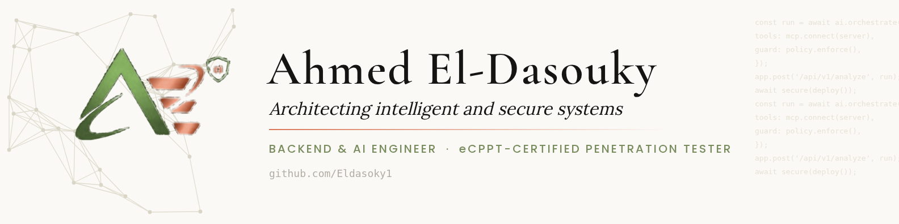

 

## About me

I like backend work where raw data turns into something people can act on. On **CompliAI**, a B2B platform for EU AI Act compliance, I'm the backend lead and AI architect: I design how the React frontend, the PostgreSQL schema and the GPT-4o pipelines fit together.

I also did an **AI internship at FlyRank** (Jul to Aug 2026), working on the automation behind organic and AI-search visibility. I also build MCP (Model Context Protocol) servers that let Claude work with real systems: a local machine, a LinkedIn account, a browser session.

I study computer science at E-JUST, where I got the basics: embedded systems, operating systems, databases, algorithms. I've taken those into real projects, including CompliAI (led a team of seven) and EcoLensAI (3rd place, Green Entrepreneurship Competition, team of four).

I work with AI coding tools every day. I set the direction and review what they produce.

## Experience

<table>
<tr><td width="28%" valign="top"><b>AI Architect / Backend Lead, CompliAI</b> Mar 2024 - present</td><td valign="top">&bull; Built the backend and AI side of a platform that automates EU AI Act compliance. &bull; Designed the React + PostgreSQL + GPT-4o pipeline that connects the frontend to the AI backend. &bull; Led seven engineers across frontend, backend and AI/ML: sprint planning and code reviews. &bull; Built agent-style workflows for processing compliance documents. </td></tr>
<tr><td width="28%" valign="top"><b>AI Intern, FlyRank</b> Jul 2026 - Aug 2026</td><td valign="top">&bull; Part of an eight-week internship on the automation layer for organic and AI-search visibility. &bull; Built pipelines that support product visibility and performance. </td></tr>
<tr><td width="28%" valign="top"><b>Backend Developer, AI-powered CRM pipeline</b> Jan 2025 - Jul 2025</td><td valign="top">&bull; Built a scraping microservice with Node.js and Puppeteer that collects page metadata. &bull; Used GPT-4o to turn messy scraped text into structured JSON. &bull; Designed a multi-tenant Supabase/PostgreSQL schema protected with Row Level Security. &bull; Delivered an Express REST API with error handling, protected routes and Jest tests. </td></tr>
</table>

## What I work with

<table>
<tr><td><b>Languages</b></td><td>    </td></tr>
<tr><td><b>Backend</b></td><td>   </td></tr>
<tr><td><b>AI and automation</b></td><td>    </td></tr>
<tr><td><b>Frontend and tools</b></td><td>  </td></tr>
</table>

## Projects

<table>
<tr><td width="50%" valign="top"><a href="https://github.com/Eldasoky1/MVP_Plan">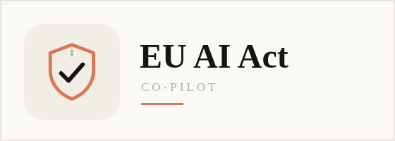</a> <b>EU AI Act Compliance Co-Pilot</b> Classifies AI projects by EU AI Act risk tier with an LLM pipeline and keyword fallbacks.      <a href="https://github.com/Eldasoky1/MVP_Plan">repo &#8599;</a></td><td width="50%" valign="top"><a href="https://github.com/Eldasoky1/linkedin-mcp">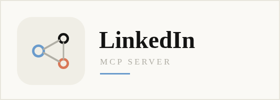</a> <b>LinkedIn Automation MCP Server</b> MCP server for LinkedIn profile management, with connection prioritization and session persistence.     <a href="https://github.com/Eldasoky1/linkedin-mcp">repo &#8599;</a></td></tr>
<tr><td width="50%" valign="top"><a href="https://github.com/Eldasoky1/claude-desktop">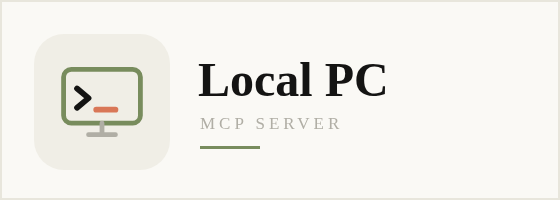</a> <b>Local PC Control MCP Server</b> Gives Claude Desktop tool-based access to a local Windows machine over stdio.     <a href="https://github.com/Eldasoky1/claude-desktop">repo &#8599;</a></td><td width="50%" valign="top"><a href="https://github.com/Eldasoky1/CRM-BackEnd">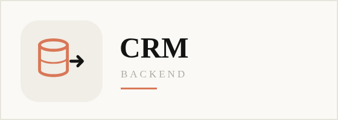</a> <b>CRM-BackEnd</b> Backend with a scraping service and GPT-4o lead enrichment, on Supabase.      <a href="https://github.com/Eldasoky1/CRM-BackEnd">repo &#8599;</a></td></tr>
<tr><td width="50%" valign="top"><a href="https://github.com/Eldasoky1/ECo">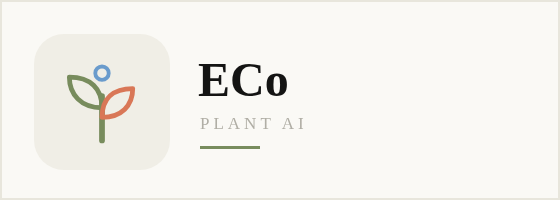</a> <b>ECo</b> Plant disease detection API using EfficientNet, with a Gemini fallback.     <a href="https://github.com/Eldasoky1/ECo">repo &#8599;</a></td><td width="50%" valign="top"><a href="https://github.com/Eldasoky1/maison-backend">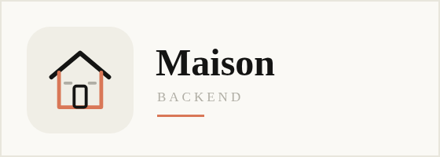</a> <b>maison-backend</b> Supabase backend: PostgreSQL schema, seed data, RLS policies, storage and AI Edge Functions.     <a href="https://github.com/Eldasoky1/maison-backend">repo &#8599;</a></td></tr>
<tr><td width="50%" valign="top"><a href="https://github.com/Eldasoky1/flyrank-ml-internship">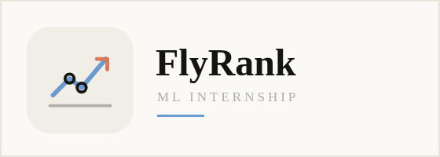</a> <b>flyrank-ml-internship</b> Work from the FlyRank ML internship, Applied Search Intelligence track: notebooks, pipeline, capstone.    <a href="https://github.com/Eldasoky1/flyrank-ml-internship">repo &#8599;</a></td><td width="50%" valign="top"><a href="https://github.com/Eldasoky1/FlyRank-assignments">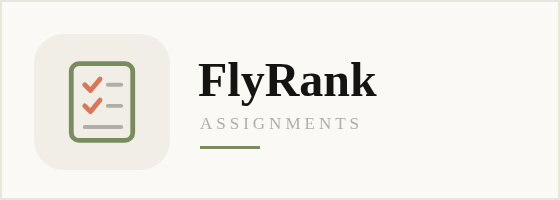</a> <b>FlyRank-assignments</b> Assignment work from the FlyRank internship, including a FastAPI + SQLite task API.     <a href="https://github.com/Eldasoky1/FlyRank-assignments">repo &#8599;</a></td></tr>
<tr><td width="50%" valign="top"><a href="https://github.com/Eldasoky1/python0">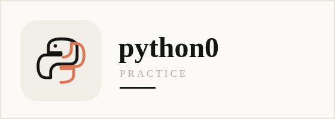</a> <b>python0</b> Early practice repository.     <a href="https://github.com/Eldasoky1/python0">repo &#8599;</a></td><td width="50%" valign="top"><a href="https://github.com/Eldasoky1/ECO-Pharma">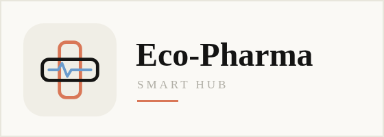</a> <b>ECO-Pharma (Smart Eco-Pharma Hub)</b> Pharmaceutical workflow platform: OTC inventory and drug catalogue, IoT cold-chain monitoring and a GPT-4o drug-interaction risk engine. University team project.      <a href="https://github.com/Eldasoky1/ECO-Pharma">repo &#8599;</a></td></tr>
<tr><td colspan="2" valign="top">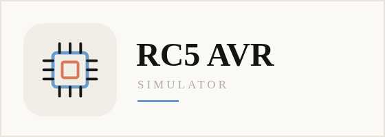 <b>RC5 AVR Microcontroller Simulator</b> Browser-based AVR simulator with a code editor, live I/O tracking and RC5 encryption in AVR assembly.    </td></tr>
</table>

## Education

- **B.Sc. Computer Science**, Egypt-Japan University of Science and Technology (E-JUST)

- 8th Baheya Breast Cancer Conference (Oct 2025): 25.75 AACME CME credits
